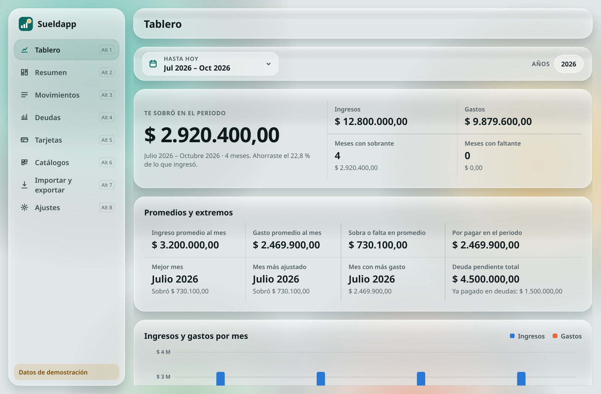
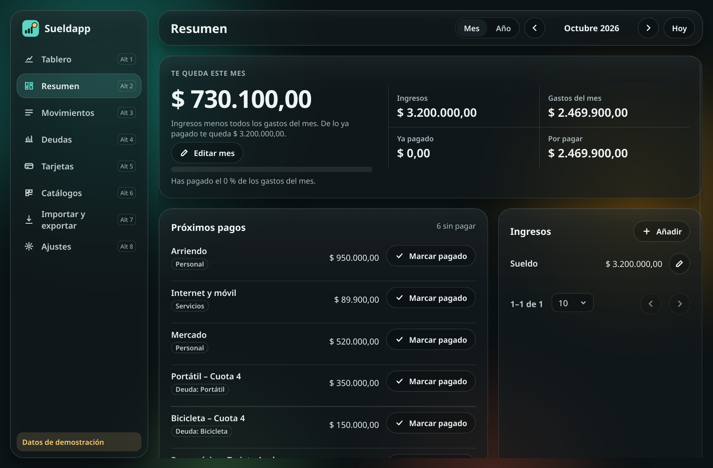
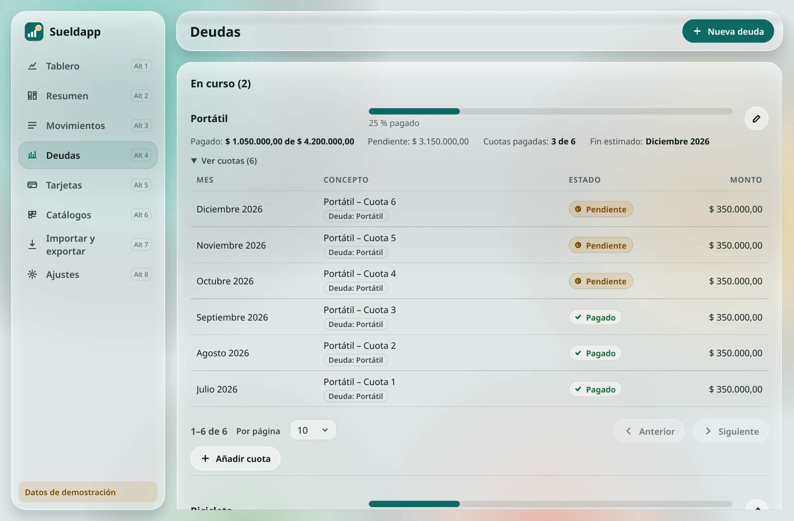

<div align="center">


# Sueldapp

**Finanzas personales de escritorio, locales y privadas.**
Sueldo, gastos del mes, deudas a cuotas y tarjetas de crédito, con un tablero de estadísticas.

[](https://github.com/CpuJP/sueldapp/actions/workflows/ci.yml)
[](https://github.com/CpuJP/sueldapp/releases)
[](LICENSE)
-informational)

[Descargar](#descargar) · [Guía de usuario](docs/guia-de-usuario.md) · [Contribuir](CONTRIBUTING.md) · [English](#english)



</div>

## Por qué

Sueldapp nació para reemplazar una hoja de cálculo de finanzas personales sin perder ni un dato:
importa la hoja, comprueba que cada total coincide **al centavo** y desde ahí todo se edita en la app.

- **Privada por diseño:** todo se guarda en tu equipo (SQLite). Sin cuentas, sin nube, sin telemetría;
  la app no hace conexiones de red.
- **Montos exactos:** aritmética decimal en todo el núcleo (Rust + `rust_decimal`), nunca coma flotante.
- **Sin quedar atrapado:** exporta a `.ods` y `.csv` cuando quieras, y vuelve a importar.

## Funciones

| | |
|---|---|
| **Tablero** | Ingresos vs. gastos por mes, lo que sobra o falta, saldo acumulado, tasa de ahorro, promedios, mejor y peor mes, gasto por categoría, destino, estado y concepto. Periodo con calendario y por años. |
| **Resumen** | El mes o el año: ingresos, gastos, lo pagado, lo que queda y los próximos pagos (márcalos pagados con un clic). |
| **Movimientos** | Búsqueda sin tildes, filtros por año, mes, estado, categoría, deuda y tarjeta; paginación por cursor. |
| **Deudas** | Total, pagado, pendiente (o "pagado de más"), progreso, cuotas y mes estimado de fin. |
| **Tarjetas** | Cupo, saldo, disponible, día de corte y de pago, y sus pagos. |
| **Catálogos** | Estados (y cuáles cuentan como pagado), categorías y fuentes de ingreso, todo editable. |
| **Importar / exportar** | Hoja original con conciliación, **plantilla para llenar a mano**, exportación `.ods`/`.csv`. |
| **Accesibilidad** | Contraste AA, uso completo con teclado, tema claro/oscuro/sistema, "reducir transparencia" y "reducir movimiento". |

<p align="center">


</p>

## Descargar

Descarga el instalador de tu sistema en [**Releases**](https://github.com/CpuJP/sueldapp/releases):

| Sistema | x64 (Intel/AMD) | ARM64 |
|---|---|---|
| **Windows 10/11** | `Sueldapp_<versión>_x64-setup.exe` o `.msi` | `Sueldapp_<versión>_arm64-setup.exe` |
| **Debian, Ubuntu, Mint** | `Sueldapp_<versión>_amd64.deb` | `Sueldapp_<versión>_arm64.deb` |
| **Fedora, openSUSE** | `Sueldapp-<versión>-1.x86_64.rpm` | `Sueldapp-<versión>-1.aarch64.rpm` |
| **Cualquier Linux** | `Sueldapp_<versión>_amd64.AppImage` | — |

```bash
# Debian/Ubuntu
sudo apt install ./Sueldapp_*_amd64.deb
# Fedora
sudo dnf install ./Sueldapp-*.x86_64.rpm
# AppImage
chmod +x Sueldapp_*.AppImage && ./Sueldapp_*.AppImage
```

Verifica la descarga con `SHA256SUMS.txt` (`sha256sum -c SHA256SUMS.txt --ignore-missing`).
Los instaladores aún no están firmados: Windows puede mostrar un aviso de SmartScreen.

> **Estado: alpha.** Haz copias de tus datos (Importar y exportar → Exportar a `.ods`).

## Empezar

1. **¿Tienes la hoja original?** Importar y exportar → *Elegir archivo e importar*. Si algún total no
   coincide, no se guarda nada y el informe explica por qué.
2. **¿Empiezas de cero o quieres cargar muchos datos?** Descarga la **plantilla**, llénala en
   LibreOffice, Excel o Google Sheets, guárdala como `.ods` e impórtala. Suma datos; no borra nada.
3. O simplemente crea gastos e ingresos desde la app.

Tus datos quedan en:

| Sistema | Carpeta |
|---|---|
| Linux | `~/.local/share/sueldapp/` |
| Windows | `%APPDATA%\sueldapp\` |

Allí también puedes poner `reglas.txt` con tus reglas de categorías y tarjetas
([ejemplo](docs/ejemplos/reglas.ejemplo.txt)).

## Compilar desde el código

Requisitos: [Rust estable](https://rustup.rs) y, en Linux, fontconfig y xkbcommon:

```bash
# Fedora
sudo dnf install fontconfig-devel libxkbcommon-devel
# Debian/Ubuntu
sudo apt install libfontconfig1-dev libxkbcommon-dev

git clone https://github.com/CpuJP/sueldapp.git && cd sueldapp
cargo run --release -p sueldapp                       # abre la app
SUELDAPP_SIN_ODS=1 cargo test --workspace             # pruebas
cargo install cargo-packager cargo-generate-rpm       # una vez
cargo packager --release -p sueldapp                  # instaladores (ver docs/RELEASES.md)
```

Modo demostración con datos ficticios:
`SUELDAPP_DB=/tmp/demo.sqlite3 SUELDAPP_DEMO=1 cargo run -p sueldapp`.

## Arquitectura

Núcleo en Rust (workspace de 4 crates) e interfaz nativa con [Slint](https://slint.dev): un solo
proceso, sin motor web, unos 40–50 MiB de memoria.

| Crate | Qué hace |
|---|---|
| `dominio` | Reglas de negocio y cálculos de dinero (sin IO), estadísticas, paginación |
| `almacen` | SQLite con migraciones versionadas |
| `ods` | Lector/escritor `.ods` propio, importador con conciliación, plantilla, CSV |
| `app` | Interfaz Slint (`ui/*.slint`) y vistas que la conectan con el núcleo |

Más en [`docs/arquitectura.md`](docs/arquitectura.md) y en las [decisiones](docs/decisiones/).
El proyecto se desarrolla con [Spec Kit](https://github.com/github/spec-kit) (`specs/`).

## Documentación

- [Guía de usuario](docs/guia-de-usuario.md)
- [Migración desde la hoja](docs/migracion.md) · [Formato de la hoja](docs/analisis-hoja.md)
- [Arquitectura](docs/arquitectura.md) · [Decisiones (ADR)](docs/decisiones/)
- [Cómo contribuir](CONTRIBUTING.md) · [Guía para forks](docs/FORKS.md) · [Releases](docs/RELEASES.md)
- [Seguridad](SECURITY.md) · [Código de conducta](CODE_OF_CONDUCT.md) · [Cambios](CHANGELOG.md)

## Licencia

[MIT](LICENSE) © 2026 Juan Pablo Giraldo Collazos.

La interfaz está hecha con [Slint](https://slint.dev) bajo su licencia
[Royalty-free 2.0](https://slint.dev/terms-and-conditions#royalty-free).

[](https://slint.dev)

---

## English

**Sueldapp** is a local-first, private desktop app for personal finances (salary, monthly expenses,
installment debts and credit cards) with a statistics dashboard. It imports a specific spreadsheet
layout with exact reconciliation, offers a fill-in template, and exports to `.ods`/`.csv`. Built with
Rust and a native [Slint](https://slint.dev) UI; no network access at runtime; exact decimal money. Installers for Linux and Windows
on x64 and ARM64 are available in [Releases](https://github.com/CpuJP/sueldapp/releases).
The UI and docs are in Spanish. MIT licensed.
