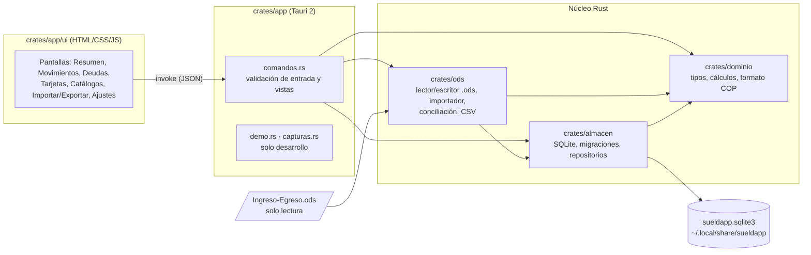

# Arquitectura

Sueldapp es una app de escritorio local. El núcleo está escrito en Rust y la interfaz es una
webview de Tauri 2 con HTML, CSS y JS sin bundler. No hay servidor ni red: los datos viven en
un archivo SQLite del usuario.

## Capas

| Crate | Responsabilidad | Depende de |
|---|---|---|
| `dominio` | Tipos (`Mes`, `Gasto`, `Ingreso`, `Deuda`, `Tarjeta`, `Estado`), reglas de la hoja (Total, Pagado, Restante, saldos), formato y lectura de montos, normalización de texto. Sin IO. | `rust_decimal`, `serde` |
| `almacen` | Apertura de SQLite (WAL, claves foráneas), migraciones con `PRAGMA user_version`, repositorios CRUD con *upsert* por `origen` y deshacer. | `dominio`, `rusqlite` |
| `ods` | Lectura del XML del `.ods` sin `f64`, fórmulas simples, extracción de la pestaña `Nómina`, importador transaccional con log, conciliación, exportación `.ods`/`.csv` y restauración. Binario `importar`. | `dominio`, `almacen`, `zip`, `quick-xml` |
| `app` | Comandos Tauri, diálogos de archivo nativos, interfaz. | todos |

## Reglas clave

- El dinero es siempre `Decimal`: en SQLite se guarda como `TEXT` y en JSON como string. La
  interfaz recibe `{valor, texto, negativo}` y nunca formatea ni suma.
- La interfaz no calcula nada: cada total sale de `dominio::calculos`.
- La CSP de la ventana es `default-src 'self'` y sin estilos en línea. No hay ningún plugin con red.
- Los gastos tienen `origen` (la celda de la hoja). Esa es la clave de idempotencia del importador.

## Datos en disco

- Base: `$SUELDAPP_DB`, o `$XDG_DATA_HOME/sueldapp/sueldapp.sqlite3`
  (por defecto `~/.local/share/sueldapp/sueldapp.sqlite3`).
- Ajustes de apariencia: almacenamiento local de la webview.
- Logs del binario `importar`: `logs/` (excluido de git).

Decisiones: ver `docs/decisiones/`.
