# Guía de usuario de Sueldapp

Sueldapp reemplaza tu hoja de cálculo de ingresos y gastos. Todo se guarda solo en tu equipo y la
app nunca se conecta a internet.

> Las imágenes de esta guía usan **datos de demostración**, no tus datos.

## 1. Primer uso: traer tu hoja

1. Abre Sueldapp. Si aún no hay datos, verás el botón **Importar mi hoja**.
2. Elige tu archivo `Ingreso-Egreso.ods`. La app solo lo lee; tu archivo no cambia.
3. Lee el informe. Si dice **Importación correcta**, todos los totales coinciden con la hoja.
   Si hay diferencias, no se guarda nada y el informe muestra cuáles son.

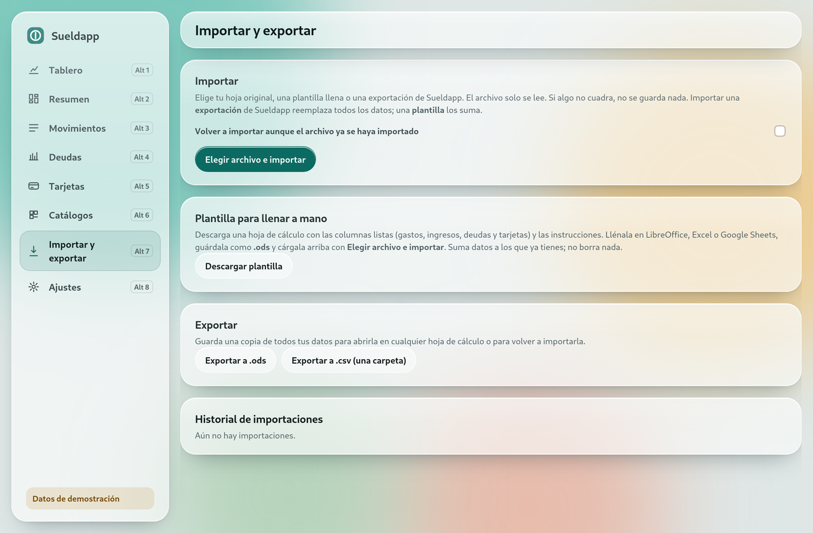

## 2. Tablero

Es lo primero que ves al abrir la app. Resume todo tu dinero en el periodo que elijas arriba:

- **Botón del periodo (con el calendario):** elige un acceso rápido (hasta hoy, este mes, últimos 3,
  6 o 12 meses, este año, año pasado, todo) o marca en el calendario el mes inicial y el final, y
  pulsa **Aplicar**. Con las flechas cambias de año; los meses sin datos se ven más tenues.
- **Años:** un clic en un año muestra ese año completo.

- **Arriba:** cuánto te sobró o faltó, tus ingresos y gastos, y cuántos meses tuvieron sobrante o
  faltante.
- **Promedios y extremos:** tu ingreso y gasto promedio al mes, el mejor mes, el más ajustado, el
  mes con más gasto y lo que aún debes.
- **Gráficos:** ingresos y gastos por mes, lo que sobra o falta cada mes (azul si sobra, rojo si
  falta) y el saldo acumulado. Pasa el puntero sobre un mes para ver sus cifras.
- **¿En qué se va el dinero?:** deudas, tarjetas y otros gastos; también por categoría, por estado,
  por concepto y los gastos más grandes.
- **Ver los datos de los gráficos en tabla:** todas las cifras en una tabla.

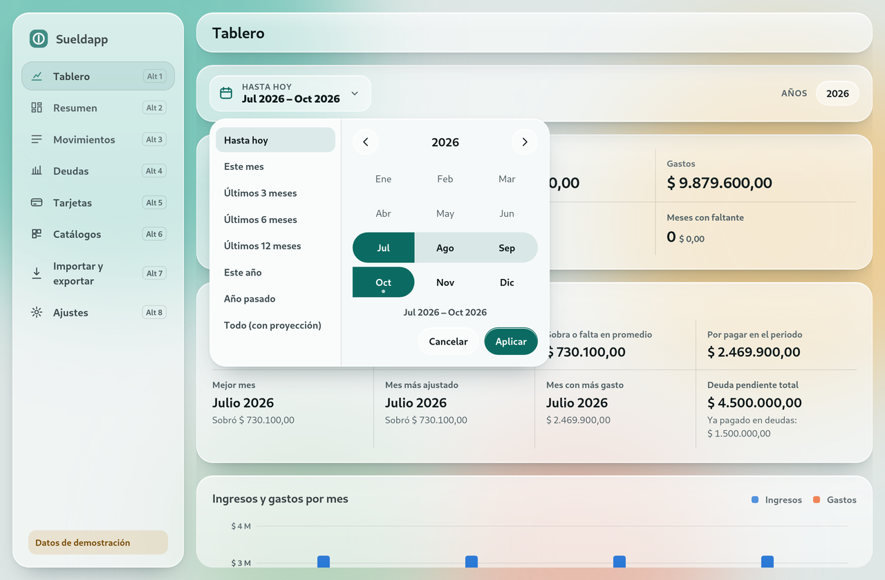
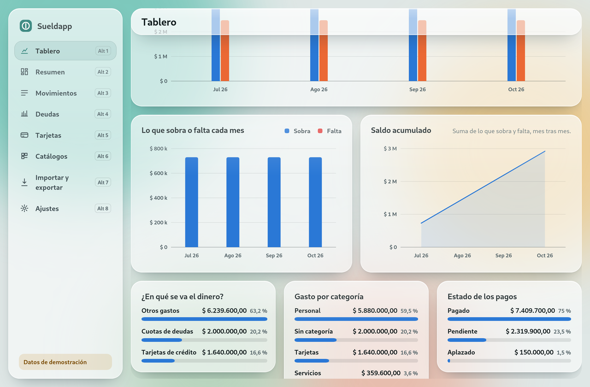
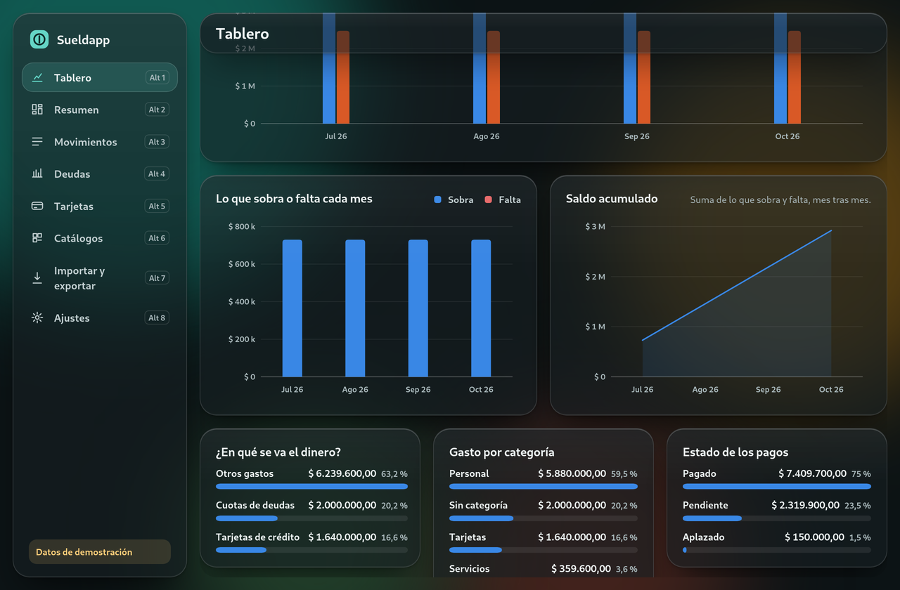

## 3. Resumen del mes

Muestra cuánto te queda este mes y qué falta por pagar.

- **Te queda este mes:** tus ingresos menos todos los gastos del mes. Si es negativo, sale en
  rojo y con signo menos.
- **Ingresos, Gastos del mes, Ya pagado y Por pagar:** las cifras del mes.
- **Próximos pagos:** los gastos que aún no has pagado. Pulsa **Marcar pagado** y listo. Si te
  equivocas, pulsa **Deshacer** en el aviso que aparece abajo a la derecha.
- Con las flechas, o con **Alt + ←/→**, cambias de mes. **Año** muestra el resumen de todo el año.

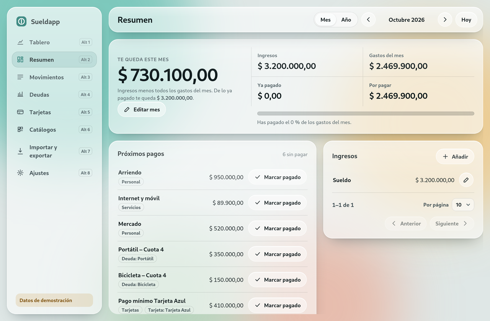

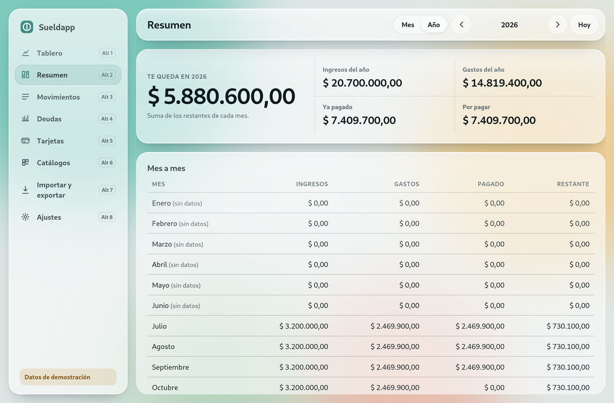

## 4. Movimientos

Aquí ves todos tus gastos de todos los meses.

- Escribe en **Buscar**. No importan las mayúsculas ni las tildes.
- Filtra por año, mes, estado, categoría, deuda o tarjeta.
- Haz clic en una fila, o pulsa **Enter** sobre ella, para editarla.
- Los movimientos aparecen del mes más reciente al más antiguo, de 10 en 10. Abajo de cada lista
  están **Anterior**, **Siguiente** y **Por página** (10, 25 o 50); la elección vale para todas
  las listas.
- **Nuevo gasto** crea un gasto. Al escribir un monto, los puntos de miles se ponen solos (`4.200.000`); la coma separa los centavos (máximo 2). El punto del teclado numérico se convierte en coma.

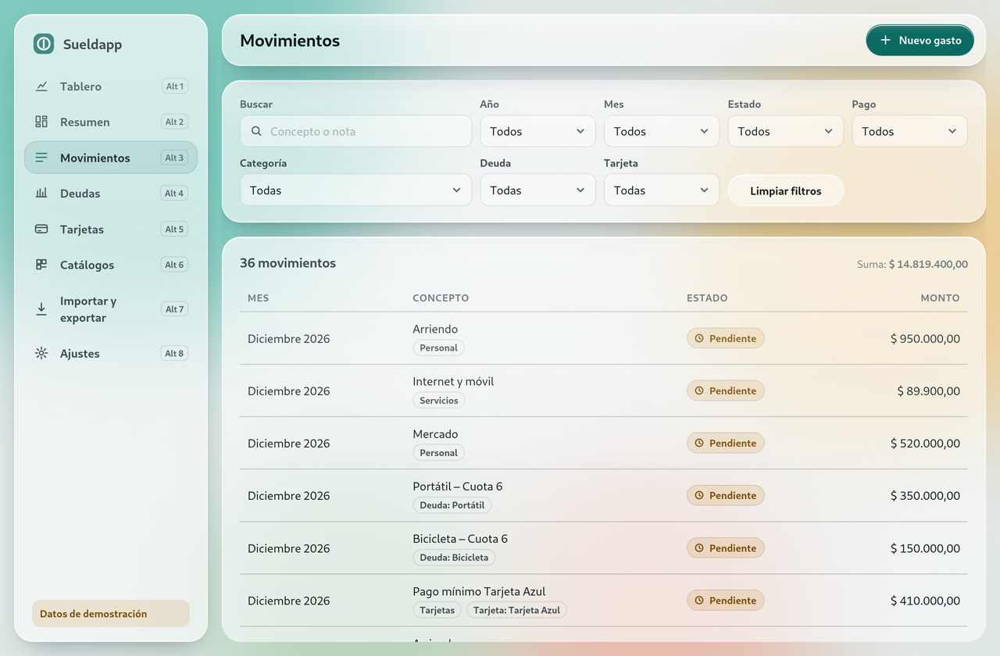
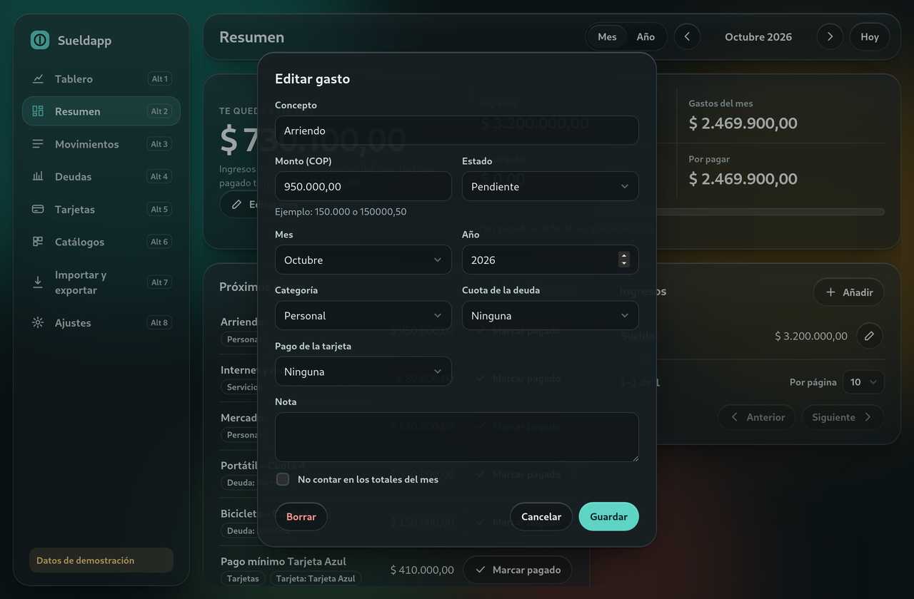

## 5. Deudas

Cada deuda muestra cuánto has pagado, cuánto falta, el porcentaje, las cuotas pagadas y el mes en
que terminas.

- Para que una cuota sume al pagado, en el gasto elige **Cuota de la deuda**.
- Si pagaste de más, la app lo muestra como "Pagado de más".
- Marca **Deuda saldada** para pasarla a la lista de saldadas.

## 6. Tarjetas de crédito

Anota el cupo, el saldo que debes, el día de corte y el día de pago. La app calcula el disponible
y lista los pagos de cada mes.

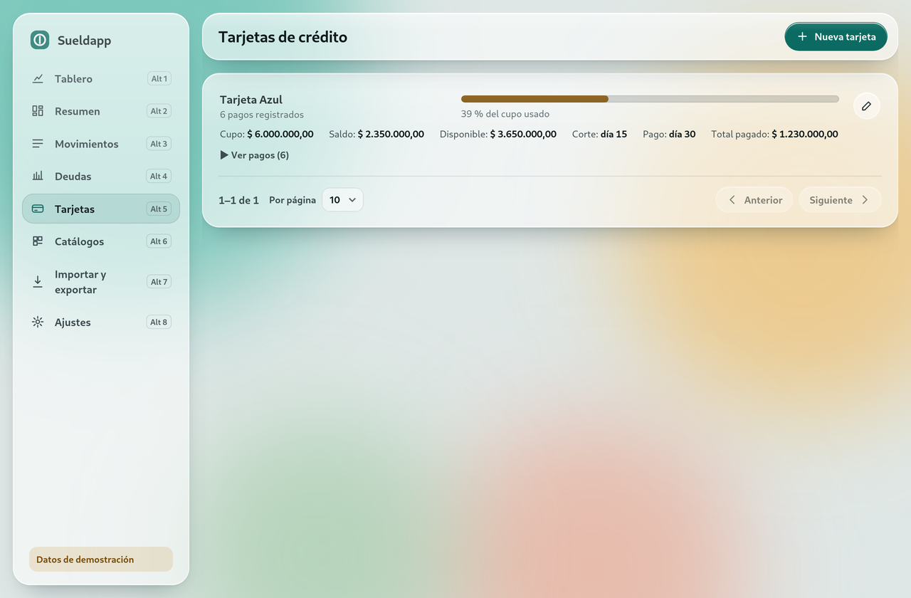

## 7. Catálogos

Edita las listas que usas:

- **Estados:** puedes indicar cuáles cuentan como pagado.
- **Categorías.**
- **Fuentes de ingreso.**

Si borras un estado o una fuente que está en uso, la app te pide a cuál pasan sus movimientos.

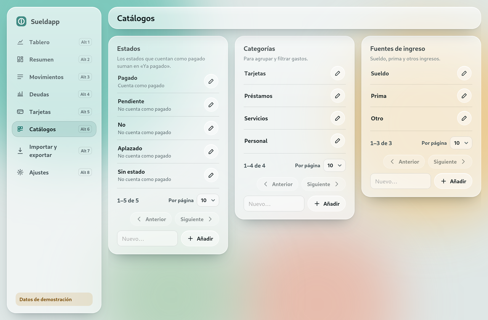

## 8. Plantilla para llenar a mano

En **Importar y exportar → Descargar plantilla** obtienes un `.ods` con hojas listas: Gastos,
Ingresos, Deudas y Tarjetas, más las instrucciones y una hoja *Listas* con los estados, categorías y
fuentes que ya existen en la app.

1. Llena una fila por registro. Año con 4 cifras; mes como número (10) o nombre (Octubre); montos
   como `150000`, `150.000` o `150000,50`.
2. Si escribes una categoría, deuda, tarjeta o fuente que no existe, la app la crea.
3. Guarda el archivo como **.ods** y cárgalo con *Elegir archivo e importar*.

Si alguna fila tiene un error, no se guarda nada y el informe te dice qué fila corregir. Importar el
mismo contenido dos veces no duplica datos.

## 9. Exportar

En **Importar y exportar** puedes guardar todo en `.ods` o en `.csv` para abrirlo en cualquier
hoja de cálculo. Si importas un `.ods` exportado por Sueldapp, se restauran todos tus datos tal
como estaban.

## 10. Ajustes y accesibilidad

- **Reducir transparencia:** cambia el vidrio por superficies sólidas.
- **Reducir movimiento:** quita las animaciones.
- **Tema:** Sistema (sigue tu configuración), Claro u Oscuro.
- Atajos: **Alt + 1…8** cambia de sección y **Escape** cierra un diálogo. Todo se puede usar con
  el teclado (Tab y Enter).

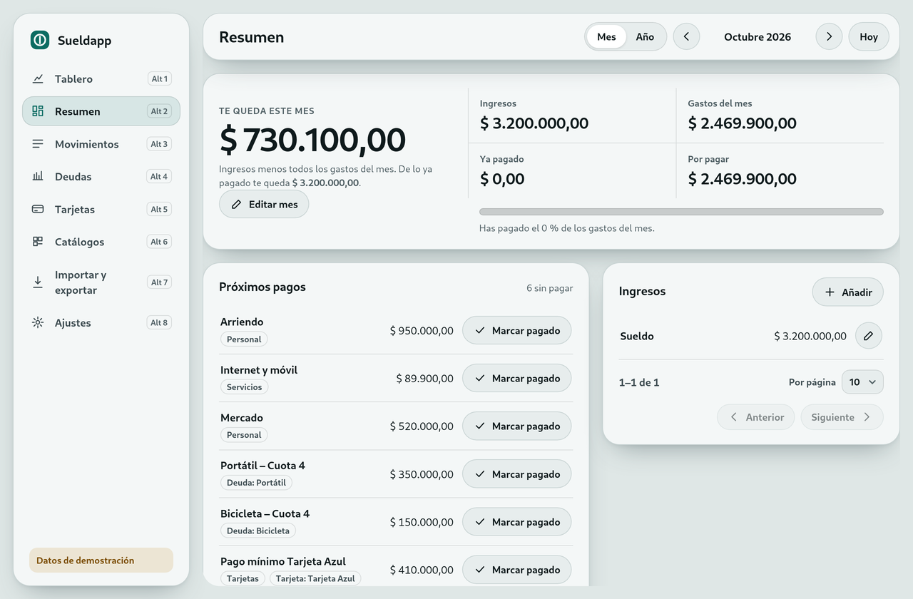
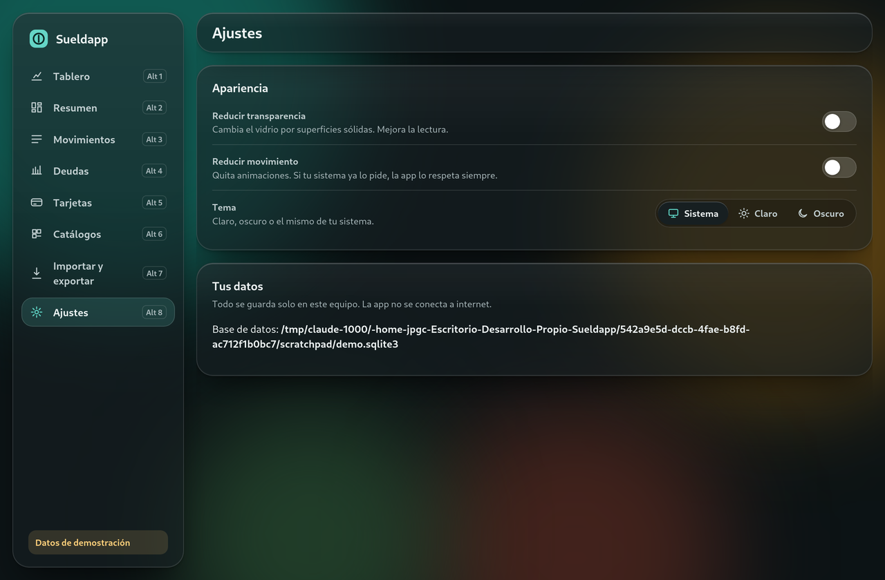
